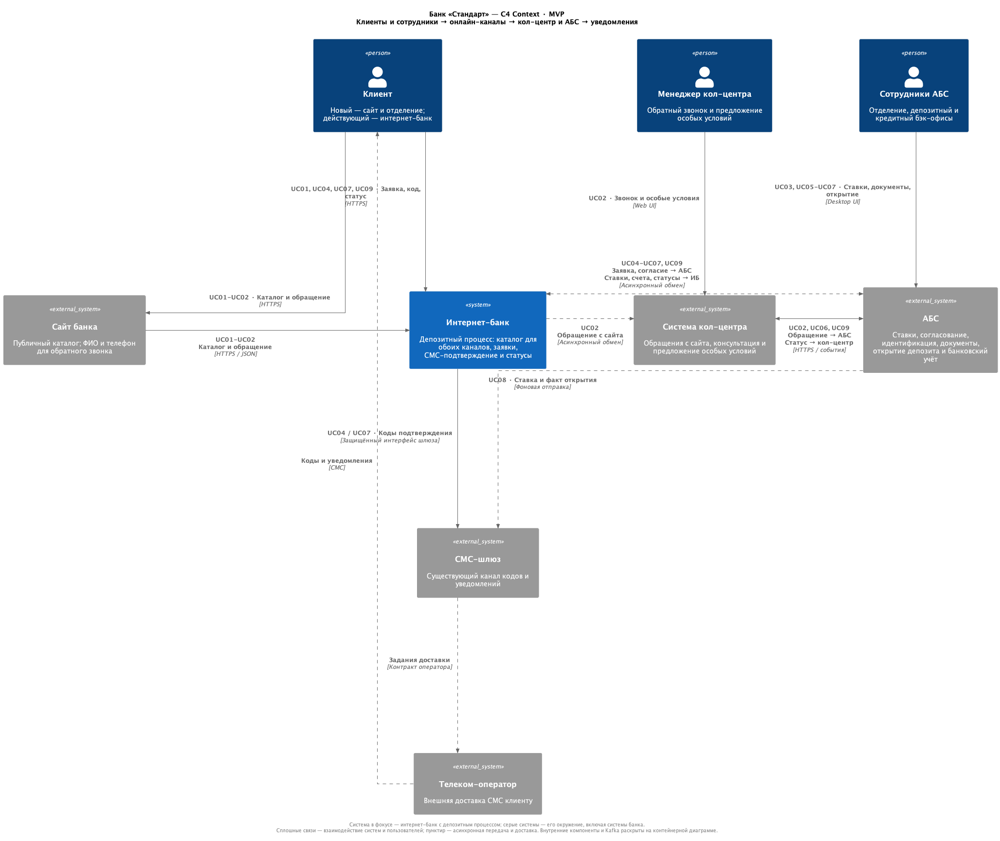
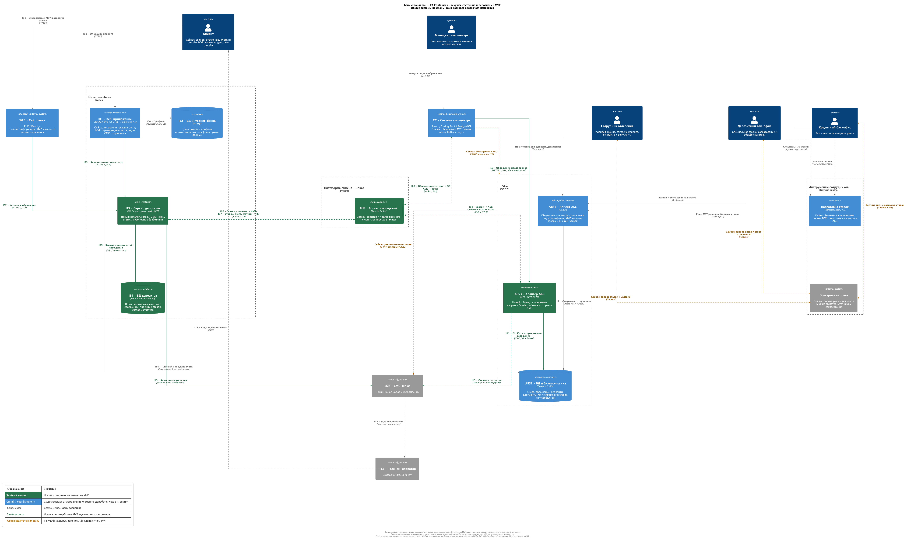

### **Название задачи:** Концептуальная архитектура открытия депозитов — MVP банка «Стандарт»

### **Автор:** vleantonov

### **Дата:** 02.11.2026

### **Функциональные требования**

|**№**|**Действующие лица или системы**|**Use Case**|**Описание**|
| :-: | :- | :- | :- |
| UC01 | Клиент, сайт, интернет-банк | Просмотр депозитов и ставок | 1. Клиент открывает список доступных депозитов на сайте или в интернет-банке. 2. Система показывает актуальные общедоступные ставки. 3. Авторизованный клиент интернет-банка также видит персональные ставки, доступные ему. 4. Клиент выбирает предложение и знакомится с условиями. Предложения с истёкшим сроком действия недоступны для подачи заявки; персональные ставки не отображаются на публичном сайте. |
| UC02 | Новый клиент, сайт, система и менеджер кол-центра, АБС | Заявка с сайта и консультация | 1. Клиент выбирает депозит, вводит ФИО и номер телефона и отправляет заявку. 2. Система принимает заявку и сообщает клиенту об успешной подаче. 3. Заявка становится доступна менеджеру в системе кол-центра. 4. Менеджер изучает её, звонит клиенту и при необходимости предлагает особые условия. 5. Обращение и предложенные условия передаются на рассмотрение в АБС; ставка согласуется по UC06. 6. Менеджер сообщает новому клиенту о необходимости посетить отделение для идентификации. |
| UC03 | Новый клиент, сотрудник отделения, менеджер депозитного бэк-офиса, АБС | Идентификация и открытие в отделении | 1. Клиент приходит в отделение после звонка. 2. Сотрудник находит обращение, проверяет документы и фиксирует результат идентификации в АБС. 3. Менеджер бэк-офиса подтверждает условия по UC06. 4. Сотрудник отделения знакомит клиента с условиями, получает его согласие и оформляет подписанные документы. 5. Сотрудник открывает депозит в АБС; без идентификации и согласия клиента открытие запрещено. 6. Клиент получает уведомление по UC08, результат обработки становится доступен сотрудникам по UC09. |
| UC04 | Действующий клиент, интернет-банк | Подача заявки в интернет-банке | 1. Клиент авторизуется в интернет-банке. 2. Выбирает депозит, указывает свой счёт и сумму и проверяет условия заявки. 3. Система отправляет СМС-код на подтверждённый номер телефона клиента. 4. Клиент вводит код, подтверждая выбранные условия. 5. Система проверяет код; он может подтверждать только эту заявку и эти условия. При неверном или просроченном коде заявка не принимается, клиенту сообщается причина. 6. После успешного подтверждения система принимает заявку и передаёт её на рассмотрение менеджеру бэк-офиса. 7. Клиент видит статус «Заявка принята». |
| UC05 | Кредитный и депозитный бэк-офисы, АБС | Ведение общедоступных и персональных ставок | 1. Кредитный бэк-офис подготавливает базовые ставки, депозитный — специальные условия с учётом оценки риска. 2. Уполномоченный сотрудник вносит или изменяет ставки в АБС в пределах своих прав. 3. Для ставки указываются период действия и область применения: продукт либо конкретный клиент. 4. После утверждения актуальные ставки становятся доступны клиентам по UC01. 5. Система сохраняет сведения о том, кто, когда и какие условия изменил. Работа со ставками не предоставляет доступа к данным других подразделений за пределами назначенных прав. |
| UC06 | Менеджер депозитного бэк-офиса, кредитный бэк-офис, АБС | Ручная обработка и согласование ставки | 1. Менеджер получает заявку на рассмотрение в АБС. 2. При необходимости запрашивает у кредитного подразделения оценку риска. 3. Проверяет предложенную ставку и подтверждает условия депозита в АБС. 4. Клиент получает СМС с согласованной ставкой по UC08. 5. Если условия онлайн-заявки отличаются от ранее подтверждённых клиентом, дальнейшее открытие требует его нового согласия по UC07. |
| UC07 | Действующий клиент, интернет-банк, менеджер бэк-офиса, АБС | Открытие депозита по онлайн-заявке | 1. Если условия изменились после первоначального согласия, клиент знакомится с ними в интернет-банке и повторно подтверждает их СМС-кодом по UC04. Без согласия на изменённые условия депозит не открывается. 2. Менеджер инициирует открытие депозита в АБС. 3. АБС проверяет принадлежность и доступность счёта, достаточность средств и согласие клиента с условиями открытия. 4. При успешной проверке АБС открывает депозит и размещает на нём указанную сумму со счёта клиента. 5. При отказе клиенту доступна причина; при успехе он получает уведомление и видит результат по UC08–UC09. Повторное рассмотрение той же заявки не приводит к повторному открытию депозита. Повторное согласие при изменении условий — дополнительное бизнес-правило, исключающее открытие на неподтверждённых условиях. |
| UC08 | Клиент, АБС, СМС-шлюз, телеком-оператор, поддержка | Уведомления о ставке и открытии | 1. После подтверждения ставки в АБС клиенту направляется СМС с согласованной ставкой. 2. После фактического открытия депозита клиенту направляется отдельное СМС об открытии. 3. Клиент получает соответствующие уведомления. 4. При временной неудаче отправка повторяется; если отправить уведомление не удаётся, поддержка получает информацию о проблеме. Эти сообщения не являются кодами подтверждения заявки. |
| UC09 | Клиент, интернет-банк, система кол-центра, АБС, поддержка | Получение статуса и восстановление обработки | 1. После изменения состояния заявки в АБС результат становится доступен участникам процесса. 2. Клиент видит статус своей заявки в интернет-банке, менеджер кол-центра — статус связанного обращения в своей системе. 3. Статус «Депозит открыт» отображается только после фактического открытия в АБС. 4. Если обработка прервана, она возобновляется без потери заявки и повторного открытия депозита. 5. Поддержка получает информацию о задержанных заявках и расхождениях статусов и организует завершение их обработки. |

### **Нефункциональные требования**

|**№**|**Требование**|
| :-: | :- |
| N01 | Шифрование трафика сайта и интернет-банка; защищённые внутренние соединения. Подтверждённый номер клиента, привязка СМС-кода к заявке и версии условий. Персональные ставки доступны только их адресату. |
| N02 | Корпоративная дизайн-система, понятные шаги и статусы. Учитывается аудитория старшего возраста: читаемые подписи, ясные ошибки, отсутствие необходимости повторного ввода после технического сбоя. Проверка сценариев с представителями пользователей. |
| N03 | Режим 24/7, доступность не ниже 99,9%, работа при отказе ЦОД под согласованной нагрузкой. Период измерения, RTO и пределы нагрузки требуют согласования. Отказоустойчивость должна охватывать весь путь пользователя, включая авторизацию в старом интернет-банке. |
| N04 | Сохранённые пользовательские данные не должны теряться при сбоях и восстановлении, включая отказ ЦОД. Для подтверждённых записей требуется RPO = 0. Успех операции нельзя возвращать до надёжной фиксации данных. |
| N05 | Идемпотентная обработка заявок и событий, восстановление согласованности после частичных сбоев, подтверждение открытия только из АБС. |
| N06 | Быстрый отклик интерфейсов в миллисекундах; пороги, перцентили и профиль нагрузки уточняются. Согласование и открытие менеджером выполняются асинхронно и не входят во время приёма заявки. Ускорение справочников платежей учитывается отдельной доработкой существующего интернет-банка. |
| N07 | Отсутствие новых прямых обращений интернет-банка к API или БД АБС в депозитном процессе; ограничение нагрузки на АБС, накопление запросов и управляемая скорость обработки. |
| N08 | Горизонтальное масштабирование новых прикладных компонентов и балансировка между экземплярами и ЦОД. АБС сохраняет единственный активный узел записи и вертикальное масштабирование; её резервная БД предназначена для восстановления, а не распределения записей. |
| N09 | Документация API, событий, состояний, эксплуатации и расширения; мониторинг сквозной обработки; изолированное тестовое окружение. Контракты допускают добавление продуктов, но в MVP реализуются только депозиты. |
| N10 | Использование компетенций и технологий банка, отдельная реализация СМС-подтверждения без изменения ядра подрядчика, совместимость с существующими системами. Kafka подключается к новым совместимым компонентам. Микросервисное выделение ограничено депозитным процессом. |
| N11 | Работа сотрудников со ставками и ручное подтверждение условий остаются в АБС. Разграничение прав депозитного и кредитного подразделений сохраняется. |

### **Решение**

**ADR-001. Статус:** архитектурное решение для оценки и согласования реализации. Требования приняты; численные параметры нагрузки, восстановления и условия эксплуатации уточняются до оценки инфраструктуры.

**Исходные сведения о банке и текущих процессах:** банк «Стандарт» развивает онлайн-каналы для привлечения клиентов. Сейчас сайт показывает маркетинговую информацию, а интернет-банк поддерживает платежи и открытие текущих счетов. Основная аудитория — люди старшего возраста, привыкшие к обслуживанию в отделениях. MVP должен обеспечить просмотр депозитов и подачу заявок через сайт и интернет-банк при сохранении ручной обработки менеджером бэк-офиса.

Сотрудники отделений работают в АБС. Кол-центр банка использует отдельную систему, в которой регистрируются обращения и передаются в АБС. Сотрудники кредитного бэк-офиса рассчитывают базовые ставки, депозитного — специальные ставки с учётом оценки риска. Ставки ведутся в XLS-файлах, подразделения обмениваются данными по электронной почте; доступ к данным друг друга ограничен. При открытии депозита новый клиент проходит идентификацию в отделении, соглашается с условиями и подписывает документы. Уведомления клиентам отправляются через СМС-шлюз и телеком-оператора.

Интернет-банк напрямую интегрирован с БД АБС для существующих операций. БД АБС перегружена и допускает только вертикальное масштабирование. Интернет-банк работает на одной группе серверов в основном ЦОД; у банка есть резервный ЦОД с возможностью переключения. Наличие резервной площадки само по себе не подтверждает выполнение требований к доступности и сохранности данных. Технологии действующих систем и необходимые изменения описаны ниже. Выбранные технологии новых компонентов и способы обмена являются решением ADR.

#### Границы и основной подход

Выделить сервис депозитов из монолита интернет-банка. Сайт и существующий интернет-банк обращаются к нему по HTTPS. Сервис хранит онлайн-заявки, подтверждения и локальные представления каталога, ставок и доступных счетов в отдельной БД MS SQL. Он обменивается сообщениями с АБС и системой кол-центра через Kafka. АБС остаётся владельцем ставок, согласования, счетов, бухгалтерских операций и факта открытия депозита.

Ручная обработка менеджером сохраняется. Сайт принимает обращение потенциального клиента; полностью дистанционное открытие новому клиенту не реализуется. Партнёрский кол-центр не включается в новый процесс: в исходных данных нет сценария его участия. Его существующие сценарии не изменяются. Excel допускается как инструмент подготовки и первоначального импорта ставок, но опубликованные ставки хранятся в АБС. Переписка по электронной почте перестаёт быть источником состояния согласования нового процесса.

Существующие прямые обращения интернет-банка к БД АБС для платежей и текущих счетов сохраняются в рамках этого ADR. На диаграмме они показаны отдельно как унаследованная связь. Расширять её для депозитов запрещено. Перевод остальных операций на новый обмен и полная замена платформы подрядчика не входят в функциональный объём MVP. При этом работы по доступности платформы и ускорению платёжных справочников остаются в плане согласно согласованным требованиям.

#### Диаграммы C4

Диаграммы приведены ниже. Отдельные файлы и редактируемые исходники доступны по ссылкам:

| Уровень | Файл для просмотра | Редактируемый исходник |
| --- | --- | --- |
| C4 Context — участники и системы MVP | [PNG](deposit-mvp-context.png) | [deposit-mvp-context.puml](deposit-mvp-context.puml) |
| C4 Container — текущее состояние и депозитный MVP | [PNG](deposit-containers.png) | [deposit-containers.puml](deposit-containers.puml) |

**Диаграмма контекста C4**

**Диаграмма контейнеров C4 — текущее состояние и депозитный MVP**

#### Компоненты и ответственность за данные

| ID на диаграмме | Компонент и технология | Назначение и изменения |
| --- | --- | --- |
| WEB | Сайт — PHP, React.js; существующая система | Страницы депозитов и форма обращения в корпоративном дизайне. PHP-бэкенд обращается к публичным методам сервиса депозитов. Клиентский браузер не получает служебные полномочия. |
| IB1 | Веб-приложение интернет-банка — ASP.NET MVC 4.5, .NET Framework 4.5; доработка | Существующая авторизация, профиль и страницы депозитов. Сервер передаёт сервису доверенный контекст пользователя и подтверждённый телефон; номер из формы не используется как источник для СМС-подтверждения. Дорабатываются доступные банку расширения, ядро СМС подрядчика не изменяется. |
| IB2 | БД существующего интернет-банка — MS SQL | Существующие данные и профиль клиента. Сервис депозитов не получает прямой доступ к её таблицам: нужный контекст передаётся сервером IB1. Актуальность и доступность подтверждённого номера проверяются на обследовании. |
| IB3 | Новый сервис депозитов — C#, поддерживаемый .NET, Kafka-клиент | API каталога, персональных предложений, заявок и статусов; проверка СМС-кодов; фоновая отправка сохранённых сообщений и обработка событий. Одна развёртываемая служба с модулями, без дробления на отдельные сервисы ставок, кодов и уведомлений. Внешние обращения ограничены публичным контрактом; персональные методы требуют доверенного пользовательского контекста. |
| IB4 | Новая БД сервиса депозитов — MS SQL | Авторитетное хранение поступивших онлайн-заявок, версий согласия, состояния подтверждения, исходящих сообщений и аудита. Локальные проекции ставок, счетов и статусов АБС. Проекции не заменяют банковский учёт. Отдельная БД и учётная запись, без общих таблиц с монолитом. |
| BUS | Платформа обмена — Kafka в инфраструктуре банка | Доставка заявок и событий, развязка скорости работы онлайн-каналов и АБС. Kafka не является единственным местом хранения заявки и не гарантирует сама по себе однократность открытия депозита. |
| ABS1 | Клиент АБС — Delphi; доработка | Рабочие места отделения и бэк-офисов: ставки, согласование, идентификация, документы и ручной запуск открытия. Сохраняются ролевые ограничения. |
| ABS2 | БД и бизнес-логика АБС — Oracle, PL/SQL; доработка | Авторитетные ставки, счета, обращения, согласованные условия, депозиты, бухгалтерия и документы. Новые процедуры приёма и обработки заявок, журнал входящих идентификаторов, исходящих событий и СМС-заданий. Результат операции и сообщения для последующей отправки сохраняются одной транзакцией. |
| ABS3 | Новый интеграционный адаптер АБС — Java, Spring Boot | Потребляет заявки из Kafka, вызывает ограниченный набор PL/SQL-процедур, публикует события АБС и отправляет уведомления через существующий СМС-шлюз. Принимает обращения кол-центра по HTTPS. Соединения с Oracle, частота запросов и параллелизм ограничены. Это компонент, принадлежащий команде АБС, а не доступ интернет-банка к таблицам Oracle. |
| CC | Система кол-центра — React.js, Spring Boot, PostgreSQL; расширение платформы подрядчика | Получение обращений с сайта из Kafka, карточка клиента, предложение особых условий, передача обращения в ABS3 и показ статусов. Расширение включает сохранение входящих идентификаторов и исходящих запросов в PostgreSQL. Существующая логическая интеграция с АБС сохраняется; новый депозитный поток проходит через адаптер. |
| SMS, TEL | Существующий СМС-шлюз и внешний телеком-оператор | Общий канал доставки кодов из IB3 и уведомлений из ABS3. Договорённости об интерфейсе, квотах, статусах и повторных отправках уточняются с владельцами шлюза. |

#### Основные интеграции

Номера I01–I14 совпадают с обозначениями на контейнерной диаграмме. Стрелка запроса обозначает также ответ; события имеют отдельное направление доставки.

| ID | Связь и протокол | Данные и поведение |
| --- | --- | --- |
| I01 | Клиент → WEB / IB1, HTTPS | Каталог, ФИО и телефон на сайте; авторизованные запросы, счёт, сумма и ввод кода в интернет-банке. |
| I02 | WEB → IB3, HTTPS/JSON | Общедоступные ставки и создание обращения. Серверные полномочия сайта не разрешают читать персональные ставки или создавать подтверждённую онлайн-заявку. |
| I03 | IB1 → IB3, HTTPS/JSON, сервисная аутентификация и защищённый контекст клиента | Личный каталог, счета, сумма, создание и подтверждение заявки, статусы. IB3 проверяет адресата предложения и принадлежность заявки; идентификатор клиента из браузера не является доверенным. |
| I04 | IB1 → IB2, SQL с защищённым соединением | Существующие данные авторизации и профиля. Порядок получения подтверждённого телефона согласуется с командой платформы. |
| I05 | IB3 → IB4, SQL с защищённым соединением | Транзакционное сохранение заявки, подтверждения, исходящих сообщений, сведений об обработанных входящих сообщениях, проекций и аудита. |
| I06 | IB3 → BUS, протокол Kafka с TLS и аутентификацией | `lead.created` для CC, `deposit.application.submitted` и `deposit.conditions.accepted` для ABS3; подтверждения обработки входящих событий. Публикация предварительно сохранённых сообщений. |
| I07 | BUS → IB3, протокол Kafka с TLS и аутентификацией | `rate.published`, `account.updated`, `deposit.status.changed`, подтверждения сохранения обращения в CC/АБС. IB3 сохраняет проекции и входящие идентификаторы. |
| I08 | ABS3 ↔ BUS, протокол Kafka с TLS и аутентификацией | Получение подтверждённых онлайн-заявок и нового согласия; публикация ставок, счетов, статусов и подтверждений обработки на основании сохранённых в АБС сообщений. Ключ упорядочивания — идентификатор заявки либо изменяемой сущности; события содержат версию. |
| I09 | CC ↔ BUS, протокол Kafka с TLS и аутентификацией | Получение обращений сайта и статусов связанных заявок; подтверждение надёжного сохранения обращения. CC не получает темы счетов и персональных предложений всех клиентов. |
| I10 | CC → ABS3, HTTPS/JSON | Обращение после разговора, предложенные условия, идентификатор исходной заявки. Повторная отправка сохранённых обращений кол-центра использует тот же ключ идемпотентности. Ответ об успехе — после сохранения в Oracle. |
| I11 | ABS3 → ABS2, JDBC/защищённый Oracle Net | Вызовы выделенных PL/SQL-процедур, выборка ограниченных порций сообщений для отправки и первоначальная выгрузка. Прямое изменение произвольных таблиц адаптеру не разрешается. |
| I12 | ABS1 → ABS2, существующий интерфейс Oracle Net | Ролевые операции сотрудников: ставки, риск, подтверждение, идентификация, документы, открытие. Защита соединения проверяется в рамках инфраструктурного проектирования. |
| I13 | IB3 / ABS3 → SMS → TEL → клиент | Отправка кодов из IB3; ставка и факт открытия из ABS3. Интеграция со шлюзом через защищённый интерфейс, формат определяется действующим контрактом. Получение результата шлюза и корреляция с заданием; доставка оператором не приравнивается к приёму сообщения шлюзом. |
| I14 | IB1 → ABS2, существующее прямое соединение | Только текущие платежи и открытие текущих счетов. Унаследованная связь вне нового депозитного маршрута; остаётся риском общей нагрузки и доступности. |

#### Ставки, счета, подтверждение и ручная обработка

Ставки вводятся и утверждаются в АБС. В MVP допускается импорт XLS с проверкой формата и предварительным просмотром; после публикации XLS не используется как источник для онлайн-каналов. Для каждой ставки задаются продукт, версия, начало и конец действия и, при необходимости, клиент. Первоначальная загрузка в IB4 выполняется адаптером порциями с согласованным лимитом; последующие изменения поступают событиями. Снимок и события согласуются по версии, чтобы обновления во время выгрузки не терялись.

Список счетов для депозитной формы читается из IB4 и обновляется событиями АБС. Он содержит только необходимые атрибуты владельца, номера/маски, валюты и доступности счёта. Существующий монолит не запрашивает Oracle ради этой формы. Перед открытием АБС повторно проверяет счёт и средства по собственным данным: локальная проекция не служит основанием для списания. Допустимое отставание проекций и правила закрытия подачи по устаревшей ставке должны быть согласованы; версия и условия, показанные клиенту, сохраняются в заявке.

Сервис IB3 сам реализует жизненный цикл СМС-кода. Код ограничен по времени и числу попыток, хранится в защищённом проверяемом представлении и используется однократно. Численные параметры согласуются с ИБ банка. Согласие связано с клиентом, заявкой, счётом, суммой и версией ставки. Изменение существенных условий требует нового подтверждения. Подтверждённый номер поступает из доверенного профиля IB1; при его отсутствии операция блокируется до подтверждения номера существующим способом банка.

Для онлайн-заявки используются состояния «Черновик», «Ожидает СМС-подтверждения», «Принята», «На рассмотрении», «Условия согласованы», при изменении условий — «Ожидает согласия клиента», затем «Готова к открытию», «Открыта» либо «Отклонена». Для сайта добавляются «Обращение передано в кол-центр» и «Ожидает идентификации». Состояния не подменяют друг друга: подтверждение СМС, согласование менеджером и фактическое открытие — разные факты. Если данных или согласия недостаточно, заявка остаётся на соответствующем этапе, а клиент видит причину.

Кредитное подразделение получает право ведения базовых ставок и предоставления результата оценки риска; депозитное — работы со специальными ставками и согласования заявки. Детальная матрица прав утверждается владельцами процессов. Журнал содержит исполнителя, время и версии условий. Сотрудник кол-центра предлагает условия, но не обходит подтверждение бэк-офиса. Открытие выполняется штатной операцией АБС после проверки условий, а не записью из нового сервиса напрямую в банковские таблицы.

#### Надёжность обмена и защита АБС

В IB4 заявка и исходящее событие сохраняются одной транзакцией. В ABS2 регистрация заявки, результат операции и соответствующие исходящие события также фиксируются транзакционно. CC использует такой же подход для приёма обращения и последующей передачи в АБС. Отправители повторяют незавершённую доставку; потребители подтверждают обработку только после сохранения результата и входящего идентификатора. Уникальность идентификатора заявки проверяется непосредственно операцией открытия в АБС.

Доставка допускает повторы. Идемпотентность обеспечивается на уровне бизнес-операции, а не обещанием «exactly once» брокера. Исходные записи и подготовленные сообщения не удаляются только на основании подтверждения Kafka: сохраняется возможность повторной отправки до подтверждения целевой системы и последующей сверки. При восстановлении брокера события можно воспроизвести из авторитетных хранилищ. Для ошибок предусмотрены ограниченные повторы с задержкой, отдельный журнал неразобранных сообщений и оповещение поддержки; ошибочная заявка не блокирует обработку остальных.

ABS3 регулирует размер порций, число соединений и параллельных операций; при превышении допустимой нагрузки замедляет потребление. Сохранение сообщения в Kafka не означает немедленного вызова Oracle. При недоступности АБС сервис продолжает показывать действительный каталог и принимать заявки в пределах доступной ёмкости хранилища; пользователю сообщается об ожидании обработки. При устаревших данных или исчерпании безопасной ёмкости приём ограничивается с понятным сообщением. Лимиты и максимальный возраст отложенных заявок входят в эксплуатационный контракт.

СМС-уведомления о ставке и открытии создаёт только АБС. Для нового процесса назначается один отправитель — ABS3; существующий механизм не должен параллельно отправлять те же уведомления. Для повторной отправки используется стабильный идентификатор задания. Если шлюз не поддерживает идемпотентность или проверку статуса, после неопределённого результата возможна повторная СМС; это фиксируется как ограничение внешнего контракта. Повторная СМС никогда не инициирует повторное открытие депозита.

#### Доступность, сохранность данных и производительность

Прикладные экземпляры IB3 и ABS3 распределяются между основным и резервным ЦОД; трафик балансируется с проверкой здоровья и запасом мощности на потерю площадки. Для IB1 отдельно требуются резервное развёртывание, доступность сессий/профилей, согласованная конфигурация и проверенное переключение. Сайт, CC и СМС-шлюз также включаются в анализ единственных точек отказа. Добавление нового сервиса не делает существующий интернет-банк отказоустойчивым автоматически.

Для MS SQL, Oracle и PostgreSQL требуется защищённая межплощадочная фиксация сохраняемых бизнес-данных, резервные копии и проверяемое восстановление. Подтверждение сохранения должно означать наличие устойчивой копии вне отказавшего ЦОД. Кандидаты для MS SQL и Oracle — синхронные режимы Always On и Data Guard соответственно; версии, редакции, лицензии и режимы проверяются DBA. [Документация Microsoft](https://learn.microsoft.com/en-us/sql/database-engine/availability-groups/windows/availability-modes-always-on-availability-groups) показывает, что одного выбора синхронного режима недостаточно для всех сценариев потери связи: нужны правила запрета незащищённой записи и безопасного переключения. [Документация Oracle](https://docs.oracle.com/en/database/oracle/oracle-database/26/sbydb/oracle-data-guard-protection-modes.html) различает режимы по компромиссу между доступностью и сохранностью данных; режим, допускающий переход к незащищённой записи, не удовлетворяет требованию сохранности данных (N04).

При утрате возможности надёжно фиксировать данные новые записи останавливаются: требование сохранности данных (N04) не ослабляется ради формального ответа «успех». Уже сохранённые данные остаются восстановимыми. Резервные копии защищают от повреждения и ошибочного изменения данных, но сами по себе не дают RPO = 0. Гарантия относится к согласованной модели отказов; одновременная необратимая потеря всех копий не может быть устранена программным решением и требует отдельно определённых мер защиты.

Два ЦОД не обеспечивают автоматически кворум при потере любой площадки. Для автоматического выбора активной стороны нужна независимая точка арбитража; её наличие в инфраструктуре банка требует подтверждения. Арбитр не является копией пользовательских данных. На этапе инфраструктурного проектирования требуется выбрать проверенную топологию репликации и кворума, исключить одновременную запись двумя активными сторонами и определить порядок работы после потери площадки. В двух площадках без дополнительной копии продолжение защищённой записи после отказа ЦОД может требовать восстановления резервирования. Это влияет на RTO и бюджет доступности и должно быть проверено до запуска, а не объявлено выполненным в ADR.

Kafka развёртывается с резервированием, подтверждением записи репликами и запретом небезопасного выбора лидера; размещение реплик и управляющего кворума проектируется под отказ ЦОД. Если кворум брокера временно недоступен, запросы сохраняются в соответствующей БД до восстановления обмена. Нельзя считать простое размещение нескольких брокеров в двух ЦОД доказательством выполнения требований доступности и сохранности данных (N03–N04). Отказоустойчивость брокера, БД и внешнего шлюза проверяется совместно с восстановлением накопившейся очереди.

Чтение каталога и счетов выполняется локально в IB4 без запроса в АБС. Приём заявки завершается после сохранения, не ожидая решения менеджера. Синхронная межплощадочная фиксация увеличивает задержку; достижимость целевого времени отклика (N06) проверяется с реальной задержкой между ЦОД. Для ускорения существующих платёжных операций команда интернет-банка отдельно профилирует загрузку платёжных справочников и реализует локальное хранение/кэширование выбранных справочных данных с контролем актуальности; состояние счетов и результаты операций произвольно кэшировать нельзя. Эта работа не считается автоматически выполненной новым депозитным сервисом.

#### Эксплуатация, безопасность и развитие

Системы используют TLS на внешних и новых внутренних соединениях, отдельные служебные учётные записи, ограничение прав на методы и темы Kafka. ФИО, телефон, коды и полные номера счетов не записываются в технические логи. В событиях передаётся минимальный набор данных для получателя; сроки хранения и доступ к журналам согласуются с владельцами данных и ИБ. Публичная форма защищается ограничением частоты запросов и автоматизированных повторов без усложнения обычного сценария для клиентов.

Все операции связываются идентификатором заявки и идентификатором события. Мониторинг охватывает доступность страниц и API, время ответа, время ожидания отправки сообщений, отставание потребителей, длительность ручной обработки, ошибки Oracle и СМС-шлюза, состояние репликации, повторные запросы и расхождения статусов. Нужны инструкции по повторной обработке, сверке, переключению ЦОД и восстановлению. Метрики доступности измеряются по пользовательскому пути, а не только по работающему процессу IB3.

Тестовое окружение содержит отдельные БД, брокер и имитацию СМС-доставки; тесты не используют производственные системы. Проверяются роли, изменение условий, повторное подтверждение, потеря ответа после фиксации, повторная доставка, сбой между записью и публикацией и повторный запуск операции открытия. Версионируются API, события и схемы БД. Новый продукт в будущем может получить отдельную обработку за тем же контрактом заявки; универсальная платформа всех продуктов в MVP не разрабатывается.

#### Команды и пакеты работ для оценки

| Участник | Пакет работ | Зависимости |
| --- | --- | --- |
| Команда интернет-банка банка — 10 человек | Страницы депозитов и интеграция IB1, сервис IB3, БД IB4, СМС-коды, проекции и статусы; обследование и ускорение платёжных справочников | Контекст авторизации и телефон, события АБС, шлюз, инфраструктура |
| Подрядчик интернет-банка — 10 человек | Консультация и проверка допустимых расширений, совместимости HTTPS, резервного развёртывания и сессий. Изменение ядра СМС не планируется | Потребность в доработках платформы определяется обследованием; их нельзя исключить заранее для обеспечения работы при отказе ЦОД (N03) |
| Команда АБС — 20 человек, включая специалистов Java | Клиент Delphi, ставки и роли, PL/SQL-процедуры и сохранение исходящих сообщений, идемпотентное открытие, ABS3, события ставок/счетов/статусов и уведомления | Правила бэк-офиса, лимиты Oracle, схема данных, инфраструктура |
| Команда сайта банка — численность не указана | Каталог, форма, PHP-интеграция и обработка ошибок в дизайн-системе | Публичный API IB3 |
| Подрядчик системы кол-центра — 5 человек; специалисты АБС участвуют при необходимости | Получение обращений через расширение Spring Boot, карточка и особые условия, Kafka, учёт отправки и обработки сообщений, вызов ABS3 и статусы; надёжность PostgreSQL | Контракты IB3/ABS3, доступность разрешённых расширений платформы |
| IT банка: инфраструктура, DBA, эксплуатация, ИБ и тестирование — состав уточняется | Kafka, БД и репликация, ЦОД, балансировка, секреты, мониторинг, резервирование, нагрузочные и аварийные испытания | Версии, лицензии, межплощадочная сеть и арбитраж; эти функции обязательны; состав ответственных подразделений необходимо уточнить |
| Владельцы СМС-шлюза в IT банка и телеком-оператор | Доступ для IB3 и ABS3, квоты, подтверждения доставки, повторные отправки и доступность | Действующий контракт и технические возможности шлюза |
| Цифровая трансформация — 10 человек; представители депозитного и кредитного бэк-офисов, отделений и кол-центра | Правила ставок, роли, состояния, согласие клиента, критерии приёмки и обучение; приоритизация и оценка вместе с менеджером проекта | Решения по открытым вопросам и проверка пользовательских сценариев |

Указана текущая численность команд; количество специалистов, выделенных на реализацию, требуется согласовать. Сроки и стоимость в ADR не назначаются. Менеджеру проекта необходимо отдельно оценить функциональные изменения, инфраструктуру/лицензии и участие подрядчиков; готовность Kafka и отказоустойчивости БД предшествует промышленному запуску.

### **Альтернативы**

| Вариант | Причина отказа или условия пересмотра |
| --- | --- |
| Расширить старый монолит и напрямую вызывать Oracle/API АБС для депозитов | Повторяет существующую связанность, увеличивает нагрузку на перегруженную БД и привязывает отклик к доступности АБС. Противоречит требованию ограничить нагрузку на АБС и исключить новые прямые обращения интернет-банка к ней (N07). |
| Подключить Kafka непосредственно к текущей платформе .NET Framework 4.5 | Текущая платформа интернет-банка несовместима с Kafka. Потребуется изменение платформы/ядра и участие подрядчика; отдельный совместимый сервис снимает эту зависимость для депозитов. |
| Отложенный обмен через таблицы заданий и HTTPS без Kafka | Возможен для небольшого MVP и снижает инфраструктурный объём. Потребуются собственные механизмы доставки, подписок и контроля нагрузки. Kafka выбрана как предпочтительная технология обмена сообщениями с учётом дальнейшего развития и нескольких независимых получателей; если банк не сможет обеспечить её эксплуатацию, вариант должен быть повторно оценён отдельным ADR. |
| Хранить и согласовывать ставки в отдельном новом сервисе вне АБС | Снижает часть нагрузки АБС, но создаёт новое рабочее место, перенос прав и согласования и дополнительного владельца бизнес-данных. Для MVP выбран существующий процесс в АБС с локальной копией для онлайн-чтения. |
| Полностью перевести интернет-банк на микросервисы | Превышает объём депозитного MVP, увеличивает участие подрядчика и число миграций. Выделяется только депозитный процесс. |
| Оставить один ЦОД и разрешить суточный простой | Не соответствует требованиям доступности 99,9% и работы при отказе ЦОД (N03). Небольшая текущая аудитория не является основанием отменять согласованные требования. |
| Асинхронная репликация как единственная защита сохранённых данных | Может снизить задержку, но допускает потерю последних записей при отказе. Не соответствует требованию сохранности данных (N04); может использоваться только как дополнительная копия, не заменяющая защищённую фиксацию. |

**Недостатки, ограничения, риски**

| Риск или ограничение | Последствие и действие |
| --- | --- |
| Сохранность данных, доступность 99,9% и работа при отказе любого ЦОД требуют совместной проверки | При потере защищённой фиксации запись останавливается; сохранность не подменяется доступностью. Уточнить модель отказов, топологию данных/кворума, RTO и бюджет простоя. Без инфраструктурной проверки выполнение требований не подтверждено. |
| Версии, редакции и лицензии MS SQL/Oracle/PostgreSQL, ресурсы резервного ЦОД неизвестны | Репликация может потребовать обновления, лицензий, дополнительных узлов и каналов связи. Включить в обследование и оценку до утверждения бюджета. |
| АБС уже перегружена | Хранение и обработка сообщений, импорт ставок, выгрузка счетов и ручные операции также создают нагрузку. Согласовать лимиты и проверить профиль нагрузки; адаптер не делает ресурсы Oracle неограниченными. |
| Старая платформа интернет-банка остаётся зависимостью | Сервис депозитов не устраняет отказ авторизации, сессий или унаследованных прямых запросов. Привлечь подрядчика к проверке HTTPS, расширений и аварийного переключения; стоимость работ может возрасти. |
| Kafka и новый runtime требуют эксплуатации | Нужны ответственные, мониторинг, обновления, обучение и испытания восстановления. Отсутствие выделенной команды не является доказательством наличия этих компетенций. |
| Проекции ставок и счетов обновляются не мгновенно | Согласовать допустимое отставание и правила устаревания; хранить версию предложения и проверять счёт в АБС перед открытием. При изменении условий получить новое согласие. |
| Ручной бэк-офис и кол-центр ограничивают пропускную способность | Быстрый приём не гарантирует быстрое открытие. Согласовать рабочие регламенты, целевые сроки обработки, штатную нагрузку и видимые клиенту статусы. Доступность системы 24/7 не означает круглосуточную работу менеджеров. |
| Контракт СМС-шлюза пока не изучен | Проверить квоты, идемпотентность, статусы и отказоустойчивость. Не считать подтверждение приёма шлюзом доказательством доставки клиенту. |
| Дополнительное согласие изменённых условий и учёт версий увеличивают объём MVP | Необходимо для связи подтверждения с реальными условиями. Утвердить перечень существенных изменений с бизнесом; оценить дополнительные страницы и состояния. |
| Время отклика, загрузки платёжных справочников и нагрузка пока не имеют численных критериев | Согласовать перцентили, максимальные задержки, количество пользователей и заявок, длительность измерения и работу после отказа ЦОД. До этого нельзя доказать производительность или корректно подобрать мощности. |
| Ускорение платёжных справочников относится к существующим платежам | Выделить обследование и оптимизацию справочников в самостоятельный пакет работ; не скрывать его стоимость внутри депозитного сервиса. |

Перед запуском должны быть приняты UC01–UC09, проверены права и защита данных, повторы и частичные сбои, восстановление сохранённых заявок без потерь, переключение ЦОД под согласованной нагрузкой и работа всех зависимостей интернет-банка. Контракты API/событий, матрица прав, параметры доступности, лимиты АБС и эксплуатационные инструкции являются результатами следующего этапа детализации, необходимыми для окончательной оценки и приёмки.
