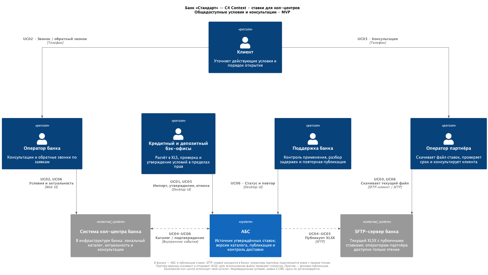
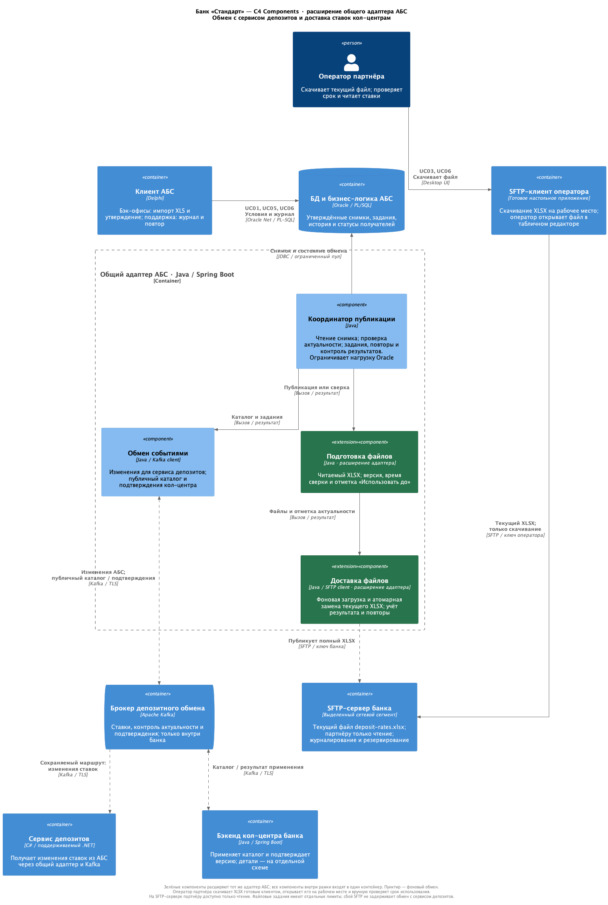
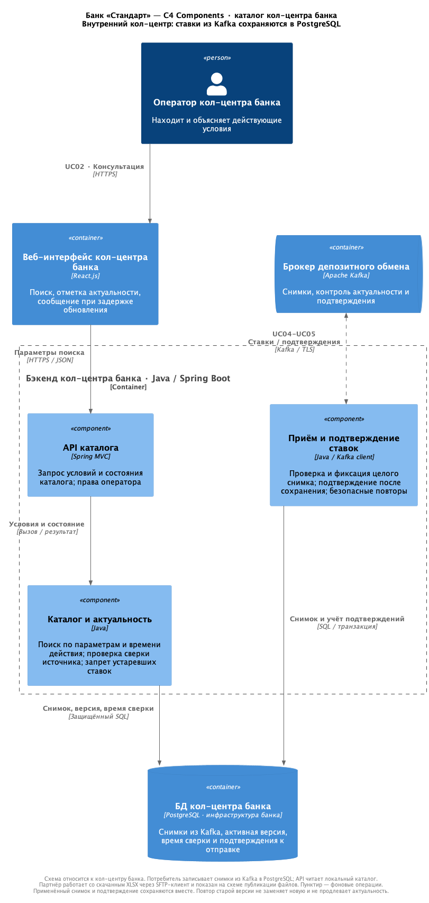

### **Название задачи:** Актуальные ставки по депозитам для кол-центра банка и партнёрского кол-центра

### **Автор:** vleantonov

### **Дата:** 02.11.2026

### **Функциональные требования**

Функциональные требования представлены сценариями использования. Оба кол-центра должны получить возможность консультировать по общедоступным ставкам к запуску MVP.

|**№**|**Действующие лица или системы**|**Use Case**|**Описание**|
| :-: | :- | :- | :- |
| UC01 | Кредитный и депозитный бэк-офисы, АБС | Подготовить и опубликовать общедоступные ставки | 1. Сотрудники рассчитывают ставки в рамках действующего процесса. 2. Уполномоченный сотрудник вносит подготовленные условия в АБС. 3. Проверяет продукт, валюту, срок, диапазон суммы, ставку и период действия. 4. После утверждения условия становятся доступными для передачи обоим кол-центрам. 5. Персональные предложения и неутверждённые условия в общедоступный каталог не включаются. |
| UC02 | Клиент, оператор и система кол-центра банка | Проконсультировать по текущим ставкам | 1. Клиент звонит в банк либо отвечает на обратный звонок по заявке. 2. Оператор открывает каталог и выбирает продукт и параметры депозита. 3. Система показывает действующие условия и время последнего подтверждения актуальности каталога. 4. Оператор объясняет условия и дальнейшие шаги открытия. 5. При запросе особых условий используется существующий процесс согласования в банке; публичная ставка сама по себе не означает одобрения индивидуальных условий. |
| UC03 | Клиент, оператор партнёрского кол-центра | Проконсультировать клиента по файлу ставок | 1. Партнёр принимает звонок. 2. Перед консультацией оператор скачивает текущий файл ставок, открывает его и проверяет время допустимого использования. 3. Находит нужный продукт и параметры депозита, объясняет условия по сценарию банка. 4. Если файл просрочен или недоступен, действует по UC06. 5. Вопросы об индивидуальных условиях и заявках передаёт в банк; партнёр не согласует персональную ставку и не открывает депозит. |
| UC04 | АБС, система кол-центра банка, оператор партнёра | Предоставить обновлённые ставки | 1. После утверждения условий банк подготавливает общедоступный каталог. 2. Система кол-центра банка получает и применяет новую версию, подтверждая результат. 3. Банк размещает полный файл ставок в доступном партнёру каталоге. 4. Оператор партнёра скачивает и читает этот файл. 5. Банк контролирует применение версии своим кол-центром и успешность размещения файла для партнёра; использование скачанного файла проверяется организационно. |
| UC05 | Бэк-офисы, система кол-центра банка, операторы обоих кол-центров | Прекратить использование отменённых условий | 1. Сотрудник исправляет или отменяет условия в АБС. 2. Каталог банка обновляется, для партнёра публикуется новый файл. 3. В системе банка отменённые и истёкшие условия исключаются автоматически. 4. Оператор партнёра скачивает текущий файл перед консультацией и проверяет срок его использования и условия продукта. Просроченная локальная копия не используется для обещания ставки. |
| UC06 | Поддержка банка, ответственное лицо партнёра, операторы | Обработать задержку или ошибку обновления | 1. Банк обнаруживает ошибку публикации, задержку подтверждения своего кол-центра либо устаревание данных; оператор партнёра может сообщить о проблеме скачивания или открытия файла. 2. Поддержка устраняет причину и повторяет публикацию. 3. В кол-центре банка просроченные ставки блокируются системой. У партнёра оператор проверяет срок файла и прекращает использовать его после указанного времени. 4. При отсутствии актуальных условий оператор следует сценарию без обещания ставки. 5. После восстановления оператор партнёра скачивает новый файл. |

### **Нефункциональные требования**

|**№**|**Требование**|
| :-: | :- |
| N01 | Оба кол-центра используют утверждённые общедоступные условия из единого источника. Консультация не должна создавать запрос в АБС. Нагрузка публикации на Oracle ограничивается независимо от количества звонков. |
| N02 | Предлагаемые пределы после утверждения: до 5 минут для применения каталога кол-центром банка и до 15 минут для размещения файла на SFTP-сервере. Источник сверяется не реже одного раза в 5 минут. Внутренний каталог блокируется после 15 минут без успешной сверки. Файл партнёра содержит время проверки источника и отметку «Использовать до» — не позднее 30 минут после проверки и ближайшего изменения условий. Оператор скачивает текущий файл перед каждой консультацией и проверяет время. Параметры согласуются с бизнесом и партнёром. Дополнительное требование задаёт проверяемый смысл актуальности; размещение файла не доказывает его своевременное прочтение. |
| N03 | Сохраняется требование банка: работа сервисов 24/7, доступность не ниже 99,9% и восстановление при отказе ЦОД. Для банковского каталога измеряются доступность чтения и срок обновления; для партнёрского маршрута — доступность SFTP-сервера и срок публикации актуального файла. Период измерения, нагрузка и RTO согласуются до оценки инфраструктуры. Готовность рабочих мест партнёра и соблюдение регламента скачивания проверяются отдельно при пилоте. |
| N04 | Сохранённые пользовательские данные в банке должны надёжно храниться и не теряться при сбоях и восстановлении, включая отказ ЦОД; для подтверждённых записей требуется RPO = 0. История утверждения, публикации файлов и подтверждения кол-центра банка сохраняются и позволяют восстановить обмен. Дополнительное распространение требования на историю публикаций нужно для расследования ошибочной консультации и повторной доставки. |
| N05 | Передача защищается шифрованием и аутентификацией. Партнёр получает только общедоступные условия; ФИО, телефоны, заявки, персональные ставки и сведения об оценке риска исключены. Адаптер имеет право публикации на SFTP-сервере, операторы партнёра — только чтения выделенного каталога. Партнёр не имеет доступа к Oracle, Kafka и внутренним API банка. |
| N06 | Операторы партнёра скачивают файлы с SFTP-сервера банка через готовый SFTP-клиент и открывают их на рабочем месте. Для MVP выбран XLSX с читаемой таблицей ставок; его открытие проверяется на рабочих местах партнёра. Интеграция с прикладной системой партнёра и API-вызовы не требуются. |
| N07 | Чтение каталога должно быть быстрым и не зависеть от задержек АБС или передачи файлов. Предлагаемый критерий — p95 не более 300 мс для API чтения внутри банка при согласованной нагрузке. Время отображения страницы и время поиска оператором проверяются отдельно. Число одновременных операторов и объём каталога определяются при обследовании; штат 200 и 100 человек не равен одновременной нагрузке. |
| N08 | Кол-центр банка применяет версию целиком, безопасно обрабатывает повторы и не заменяет новую версию старой. На SFTP-сервер публикуется только полностью сформированный файл; частичная загрузка недоступна операторам. Отмены и сроки учитываются при формировании. Оператор не использует файл, который не открывается, просрочен или не содержит отметок версии и срока. Дополнительное требование предотвращает смешение выпусков и использование неполных или отменённых условий. |
| N09 | Используются существующие технологии и команды: Oracle/PL-SQL и Delphi для АБС, Java/Spring Boot для адаптера и кол-центра банка, PostgreSQL кол-центра банка. Для публикации ставок и доставки файлов расширяется общий адаптер АБС, предусмотренный для обмена с сервисом депозитов. Повторно используется Kafka депозитного обмена. IT банка выбирает поддерживаемый SFTP-сервер, а партнёр использует готовый клиент и средство просмотра XLSX. |
| N10 | Нужны аудит публикаций, контроль версии и задержки кол-центра банка, времени размещения файла и доступа к SFTP-серверу, уведомления поддержки и инструкции восстановления. Срок хранения истории согласуется с владельцем процесса. Для партнёра проводят выборочные проверки используемых файлов и соблюдения регламента. Дополнительное требование помогает обнаруживать задержки; журнал скачивания не доказывает, что оператор открыл файл или использовал его при консультации. |
| N11 | Каталог в кол-центре банка следует принятому стилю интерфейса; параметры продукта, срок действия и актуальность читаемы. Операторы обоих кол-центров получают согласованные сценарии разговора, включая объяснение визита в отделение новому клиенту. Дополнительное требование учитывает аудиторию старшего возраста и снижает повторные звонки. |
| N12 | Ошибки файлового обмена, медленная работа SFTP или недоступность рабочего места партнёра не должны задерживать обмен АБС с сервисом депозитов. Дополнительное требование защищает основной депозитный процесс при расширении общего адаптера новым каналом доставки. |

### **Решение**

**ADR-002. Статус:** предложено для планирования. Горизонт проекта — 6 месяцев (два квартала), MVP — к концу месяца 6 от старта проекта. Параметры актуальности, нагрузки и восстановления согласуются до реализации.

**Контекст.** Кредитный бэк-офис рассчитывает базовые ставки, депозитный — специальные условия; используются XLS-файлы и электронная почта. АБС банка — Delphi и Oracle с логикой на PL/SQL. Её база перегружена. Кол-центр банка использует платформу подрядчика в инфраструктуре банка: React, Java/Spring Boot и PostgreSQL. В нём работают 200 операторов; у партнёра — 100. Подрядчик программной платформы банка и партнёрский кол-центр — разные организации.

Для партнёра выбран простой файловый процесс: оператор скачивает файл с SFTP-сервера банка через готовый клиент и открывает на своём рабочем месте. В новую интеграцию не входят прикладная система партнёра, импорт в неё и отдельная база данных. Обратные звонки по заявкам и предложение особых условий остаются в кол-центре банка. Партнёр консультирует по общедоступным условиям и сценариям разговора банка; заявки и персональные данные ему не передаются.

**Допущение: доработка АБС не требуется.** Справочник ставок, импорт XLS, права, утверждение и история версий, публичные снимки и задания публикации, рабочее место менеджера, проверки заявок, открытие депозитов и статусы считаются уже реализованными. Существующие интерфейсы АБС позволяют адаптеру читать ставки и результаты, передавать заявки и фиксировать результаты обмена без изменений Delphi, PL/SQL и схемы БД. В проект входят проверка этих возможностей, перенос данных штатными средствами и интеграционные испытания. Доработки выполняются в отдельном адаптере АБС и других системах.

**Источник ставок.** В MVP сотрудники продолжают подготовку ставок в XLS. По принятому допущению в АБС уже доступны проверяемый импорт, права кредитного и депозитного бэк-офисов, утверждение и история версий; используются штатные функции. Владельцы ставок сверяют первоначальную загрузку. Только утверждённый справочник АБС становится источником публикаций. Рабочий XLS и письмо не меняют условия у операторов. Исправление или отмена оформляются новой версией; история сохраняется.

**Переиспользование адаптера АБС.** Общий адаптер на Java/Spring Boot уже предусмотрен архитектурой для передачи изменений ставок, счетов и статусов из АБС в сервис депозитов через Kafka. В этот же контейнер добавляются компоненты подготовки XLSX и размещения файлов на SFTP-сервере. Переиспользуются доступ к Oracle, версионирование, сохранение заданий и повторы. Владельцем остаётся команда АБС. Наличие компонентов в архитектуре не означает их готовность к эксплуатации; план включает общий адаптер и его расширение.

Кол-центр банка получает публичный каталог через Kafka и подтверждает применение версии. Для партнёра адаптер фиксирует успешное размещение полного файла на SFTP-сервере. Файловые задания выполняются фоновыми обработчиками с отдельными лимитами, тайм-аутами и ограниченными повторами; обращения к Oracle учитывают общий лимит адаптера. Обмен с сервисом депозитов не ожидает завершения SFTP-передачи. Отказ или замедление файлового канала проверяются по N12.

**Диаграмма контекста C4.** Пользователи расположены сверху, системы — под ними. В фокусе — АБС как источник ставок. Оператор партнёра обращается к SFTP-серверу банка через клиент. Пунктир — фоновая публикация.

[Исходник PlantUML](call-center-rates-context.puml)

**Диаграмма компонентов C4: общий адаптер АБС.** Зелёным выделены добавляемые компоненты подготовки и размещения файлов внутри того же Java-приложения. Оператор партнёра скачивает XLSX готовым SFTP-клиентом и открывает его в табличном редакторе или просмотрщике. Сохраняемый маршрут ставок в сервис депозитов показан для связи с основным обменом; остальные обязанности адаптера здесь не детализируются.

[Исходник PlantUML](rate-publication-components.puml)

**Диаграмма компонентов C4: бэкенд кол-центра банка.** PostgreSQL на этой схеме относится к внутреннему кол-центру банка. Потребитель получает ставки через Kafka и записывает локальный каталог в PostgreSQL. React-интерфейс читает его через API. Партнёрский сценарий показан на предыдущей схеме.

[Исходник PlantUML](call-center-catalog-components.puml)

| Компонент или система | Ответственность и изменение |
| --- | --- |
| Клиент и БД АБС | Существующие функции без доработки: импорт XLS, проверка, утверждение, история и подготовка публичного снимка. Снимок и задание публикации сохраняются в одной транзакции. Права бэк-офисов разделены. |
| Координатор публикации общего адаптера | Читает снимок через ограниченный пул, проверяет актуальность источника, управляет заданиями и повторами. Хранит результаты применения в кол-центре банка и размещения файла на SFTP-сервере. |
| Обмен событиями в адаптере | Продолжает обмен с сервисом депозитов. Публикует публичный каталог и сведения об актуальности для кол-центра банка, принимает его подтверждения. |
| Подготовка файлов в адаптере | Формирует XLSX с действующими общедоступными ставками, версией и видимым сроком использования. Ставки не рассчитываются заново. |
| Доставка файлов в адаптере | Размещает полный XLSX на SFTP-сервере, атомарно заменяет текущую публикацию, фиксирует результат и повторяет попытку при ошибке. |
| Kafka | Общий внутренний обмен. Публичные ставки, контроль актуальности и подтверждения имеют отдельные темы и права. Партнёру Kafka недоступна. |
| Сервис депозитов | Получает изменения АБС через Kafka. Файловая доставка выполняется общим адаптером АБС. |
| Приём и подтверждение ставок кол-центра банка | Получает снимок через Kafka, проверяет версию, сохраняет его в PostgreSQL и после фиксации подтверждает применение. |
| API каталога; каталог и актуальность | Проверяют права оператора, параметры и сроки условий. Читают PostgreSQL кол-центра банка; просроченный каталог блокируется по N02. |
| React-интерфейс кол-центра банка | Поиск условий, время сверки и понятное сообщение при задержке. |
| SFTP-сервер банка | Выделенный сетевой сегмент и каталог с текущим файлом. Адаптер имеет право публикации, партнёр — только чтения. Настраиваются ключи, квоты, журналирование и резервирование. |
| SFTP-клиент оператора партнёра | Готовое настольное приложение для скачивания. Оператор открывает XLSX в табличном редакторе или просмотрщике, проверяет срок и читает ставки. |

**Интеграции.**

| Связь | Данные и способ обмена | Правило обработки |
| --- | --- | --- |
| Бэк-офис → клиент АБС → Oracle | XLS-импорт, утверждение; Delphi и PL/SQL | Ошибки и конфликты сроков проверяются до публикации. |
| АБС ↔ общий адаптер | Защищённые JDBC/Oracle Net и процедуры | Публичный снимок, задания и результаты. Частота опроса, пул и размер пакета ограничиваются по результатам испытаний Oracle. |
| Адаптер → Kafka → сервис депозитов | Сохраняемый обмен ставками, счетами и статусами; Kafka/TLS | Продолжается независимо от файлового канала. На схеме показана только часть обмена, относящаяся к ставкам. |
| Адаптер ↔ Kafka ↔ кол-центр банка | Каталог, контроль актуальности и подтверждение версии; Kafka/TLS | Собственная группа потребителей. Снимок применяется целиком, подтверждение отправляется после записи в PostgreSQL. |
| React → API → PostgreSQL кол-центра банка | HTTPS и защищённый SQL | Каждый запрос оператора читает локальный каталог и не обращается к АБС. |
| Адаптер → SFTP-сервер банка | Полный XLSX; SFTP | Служебная учётная запись банка публикует файл. Результат означает успешное размещение на сервере. |
| Оператор → SFTP-клиент → SFTP-сервер | Скачивание текущего XLSX; SFTP | Права только на чтение. Оператор вручную открывает скачанную копию и проверяет срок её использования. |

**Файл для оператора партнёра.** XLSX содержит один лист ставок, действующих на момент выпуска. Вверху указаны версия справочника, номер публикации, время успешной сверки источника и крупная отметка «Использовать до» с часовым поясом МСК. Таблица содержит продукт, валюту, срок, диапазон суммы, годовую ставку и существенные условия её применения. Будущие условия не выдаются за действующие. При отсутствии предложений файл явно сообщает об этом.

Текущая публикация размещается под постоянным именем `deposit-rates.xlsx`. Адаптер сначала загружает файл во временный каталог банка, затем атомарно заменяет текущую публикацию. Возможность атомарного переименования проверяется при настройке сервера. Незавершённые загрузки и архив прежних выпусков операторам недоступны. Каждый выпуск имеет свой номер; версия справочника может сохраняться, если обновилась только отметка проверки источника.

**Актуальность и ручное использование.** После успешной сверки с АБС адаптер обновляет отметки в XLSX, даже если ставки не изменились. Время «Использовать до» ограничено сроком N02 и ближайшим известным началом или окончанием действия условий. При недоступности АБС этот срок не продлевается. Отмена ставки приводит к новому выпуску. Для кол-центра банка актуальность по-прежнему подтверждается контрольными сообщениями через Kafka.

Перед каждой консультацией оператор партнёра скачивает текущий файл и открывает именно скачанную копию. Проверяет время «Использовать до» и параметры продукта. Если срок истёк во время разговора, файл скачивается заново; при отсутствии актуальной версии оператор не обещает ставку. Регламент включает удаление старых копий и запрет консультаций по прежним вложениям или распечаткам. Часы рабочих мест синхронизируются. Обычный SFTP-клиент и XLSX не блокируют просроченные файлы автоматически — соблюдение правила контролирует руководитель партнёра.

**Надёжность и контроль.** АБС сохраняет утверждённые данные и задания публикации атомарно. Исходные снимки и история доступны для восстановления. Кол-центр банка сохраняет снимок и ожидающее отправки подтверждение вместе, безопасно обрабатывает повторы и отклоняет старые версии. Большой снимок разбивается на части одной версии и применяется только после получения всех частей. Обработчики адаптера координируют задания, чтобы ранняя публикация не заменила более новую.

Для партнёра контролируются результат размещения, возраст файла и доступность SFTP. Журнал скачивания показывает технический доступ, но не доказывает прочтение или использование файла при разговоре. Обратные файлы подтверждения и автоматический учёт применения у партнёра не используются. Руководитель партнёра проводит выборочные проверки, операторы сообщают о проблемах через согласованный канал поддержки.

**Эксплуатация.** Команда АБС отвечает за справочник и адаптер; подрядчик кол-центра банка — за потребителя, PostgreSQL и интерфейс. IT банка обеспечивает Kafka, SFTP-сервер, ключи, контроль публикаций и восстановление. Партнёр настраивает рабочие места и обеспечивает соблюдение регламента скачивания. Бизнес согласует сценарии консультаций, распределение и перевод звонков. Способ оповещения поддержки и возможности телефонии уточняются до запуска.

Резервный ЦОД сам по себе не доказывает выполнение N03–N04: нужны репликация, ресурсы и испытания переключения. При кратком сбое каталог банка и скачанный файл допустимы только в пределах N02. При невозможности надёжно сохранить запись система не сообщает об успехе. Доступность и сохранность данных обеспечиваются в MVP.

| Сценарии | Покрытие на схемах и проверка |
| --- | --- |
| UC01, UC05 | Бэк-офисы → клиент АБС → Oracle → публикация. Проверить права, утверждение, отмены и сроки. Для партнёра проверить формирование нового полного файла и ручной отказ от просроченной копии. |
| UC02 | Оператор банка → React → API → PostgreSQL банка. Проверить поиск без запроса к Oracle. |
| UC03 | Клиент → оператор партнёра → SFTP-клиент → SFTP-сервер. Проверить скачивание, открытие XLSX, срок и тестовую консультацию. |
| UC04 | Адаптер → Kafka → кол-центр банка с подтверждением; адаптер → SFTP-сервер → скачивание оператором. Сверить условия в банковском каталоге и XLSX. |
| UC06 | Контроль публикации, поддержка и операторы. Проверить ошибки SFTP, задержку подтверждения кол-центра банка, просроченный файл, действия оператора и восстановление. |

[Дорожная карта draw.io](deposit-roadmap.drawio) содержит две страницы с планом MVP на шесть месяцев: Q1 — М1–М3, Q2 — М4–М6. На обеих страницах инфраструктура и метрики распределены по шести дорожкам систем: АБС, сервис депозитов, интернет-банк, сайт банка, система кол-центра банка и система кол-центра партнёра. Дорожка «АБС» содержит разработку адаптера в М2–М3, тестирование в М4, три параллельные интеграции в М5: с системой депозитов, системой кол-центра банка и SFTP-сервером кол-центра партнёра, запуск в первой половине М6 и сбор метрик для оценки MVP во второй. Подготовка инфраструктуры завершается перед разработкой адаптера; существующие функции АБС используются без доработки. Внутри дорожек показаны этапы: планирование изменений в М1, разработка после согласования плана, тестирование, миграция старых данных и запуск; на дорожке кол-центра партнёра показаны «Подготовка SFTP-сервера» в М2–М4, его интеграция с адаптером АБС в М5, «Запуск MVP» в первой половине М6 и «Сбор метрик для оценки MVP» во второй половине М6. В сервисе депозитов определение метрик системы выполняется в М1 параллельно планированию изменений; интеграция с системой АБС показана в М5 параллельно интеграциям адаптера. Отдельная задача инфраструктуры сервиса депозитов убрана; сбор метрик для оценки MVP перенесён на вторую половину М6 после запуска в первой половине месяца. В интернет-банке и сайте банка отдельные задачи инфраструктуры убраны, определение метрик остаётся в М1, сбор метрик для оценки MVP следует во второй половине М6 после запуска в первой половине. В кол-центре банка показаны подготовка инфраструктуры в М2–М4, определение метрик в М1, проверка в М5 и сбор и анализ данных пилота в М6. Отдельная задача сбора метрик кол-центра в М2–М4 убрана. На всех дорожках в М5 после разработки или подготовки выделены интеграции с взаимодействующими системами: дополнительно показаны API сервиса депозитов для сайта и интернет-банка, обмен обращениями с кол-центром через Kafka и участие обеих сторон каждого подключения. Длительности предварительные и требуют оценки командами.

### **Альтернативы**

| Альтернатива | Оценка |
| --- | --- |
| Автоматический импорт файлов в систему партнёра | Требует доработок, интеграционных проверок и сопровождения на стороне партнёра. Для выбранного сценария достаточно готового SFTP-клиента и просмотра файла оператором. |
| Прямое чтение ставок из АБС при каждом звонке | Увеличивает нагрузку на перегруженную Oracle и связывает консультацию с её доступностью. Локальный каталог банка и опубликованный файл отделяют чтение от учёта. |
| Периодическая загрузка каталога кол-центром банка через API адаптера | Допустимая альтернатива для небольшого объёма. Выбрано повторное использование Kafka депозитного обмена; отдельная оценка нужна, если инфраструктура брокера не будет готова. |
| Рассылка рабочих XLS по электронной почте | Близка к текущему процессу, но затрудняет выбор актуального утверждённого выпуска. SFTP даёт единое место скачивания текущего файла; риск старой локальной копии всё равно контролируется регламентом. |
| Доступ партнёра к API, Kafka или внутреннему веб-интерфейсу банка | Не соответствует выбранному файловому сценарию и расширяет интеграцию. Оператору достаточно доступа к выделенному каталогу SFTP. |
| Файл только с изменёнными строками | Оператору пришлось бы объединять несколько файлов и учитывать отмены вручную. Полная таблица действующих условий удобнее для консультации. |
| Отдельная система управления ставками | Дублирует справочник и утверждение в АБС, добавляет владельца данных и интеграции. Для MVP используется общий адаптер и текущий банковский процесс. |

**Недостатки, ограничения, риски**

| Риск или ограничение | Последствие и действие |
| --- | --- |
| Оператор использует старую локальную копию | SFTP-клиент не блокирует её открытие. Нужны видимый срок, скачивание перед консультацией, обучение и выборочные проверки руководителем партнёра. Автоматическая гарантия использования последнего файла отсутствует. |
| Между утверждением, публикацией и скачиванием есть задержка | Условия каналов могут кратковременно различаться. Контролируются N02 и срок файла; окончательные условия подтверждаются банковским процессом. |
| SFTP или рабочее место недоступны | Допустима только ещё действующая скачанная копия. После указанного срока оператор консультирует без обещания ставки и обращается в поддержку. |
| Oracle остаётся источником и узким местом | Ограничить опрос и размеры пакетов, индексировать журнал, согласовать хранение и испытать публикацию вместе с основными банковскими операциями. |
| Общий адаптер выполняет основной обмен и публикацию файлов | Отдельные лимиты и повторы файловых заданий защищают основной процесс; проверить продолжение обмена с сервисом депозитов при отказе SFTP. |
| Рабочие места партнёра не обследованы | Проверить установку клиента, открытие XLSX, права только на чтение, синхронизацию часов и удобство поиска ставок. Приёмка включает обычных операторов. |
| SFTP-сервер, Kafka и репликация требуют эксплуатации | Назначить владельцев, настроить резервирование и смену ключей. Ресурсы ЦОД, лицензии БД и межплощадочную сеть обследовать до утверждения сроков. |
| Подрядчик кол-центра банка сопровождает платформу небольшой командой | Каталог и обработка заявок конкурируют за специалистов. Согласовать контракты и окна совместных испытаний заранее. |
| Расчёты в XLS сохраняются в MVP | Импорт, проверка и утверждение уменьшают риск ошибки; в рамках шестимесячного MVP расчёты выполняются в XLS. |
| Нагрузка и выделение команд пока не оценены | Шесть месяцев — плановый горизонт. В первом месяце проверить прогноз звонков, ресурсы, участие подрядчиков и телефонию. Массовая реклама запускается после пилота обоих кол-центров. |

Приёмка включает UC01–UC06, согласованные N02–N03 и N07, сверку каталога банка и XLSX, отказ ЦОД, права партнёра только на чтение и публикацию без частичных файлов. Операторы демонстрируют скачивание, открытие, проверку срока и действия при просроченном файле. По N12 проверяется обмен с сервисом депозитов при отказе или замедлении SFTP. Для общего MVP также принимаются онлайн-заявки, ручная обработка в АБС, подтверждение и уведомления по СМС.
